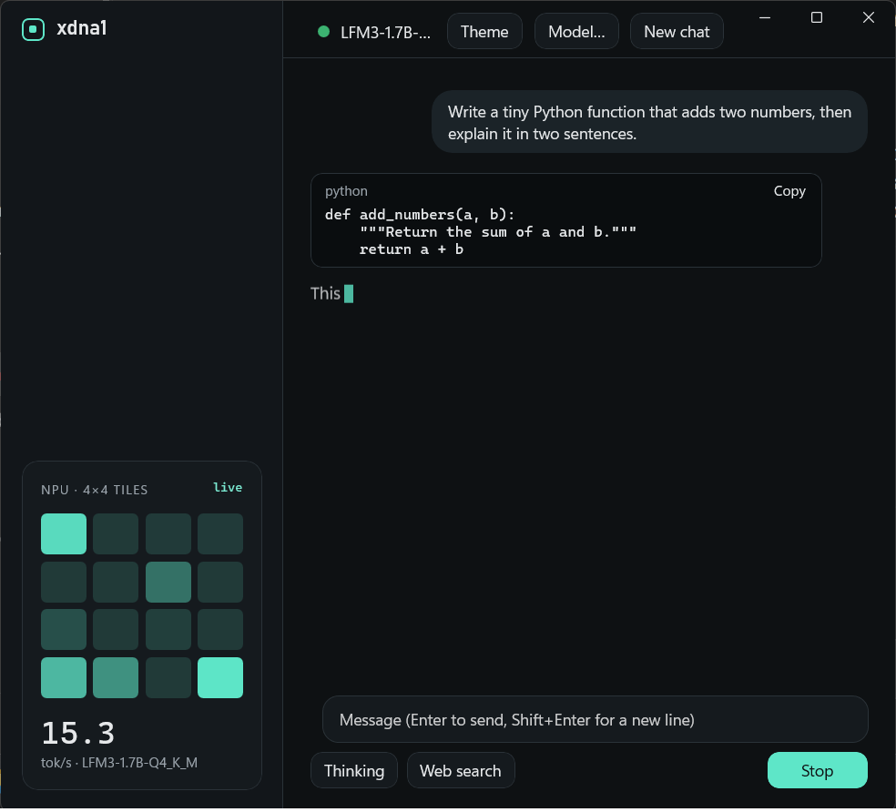
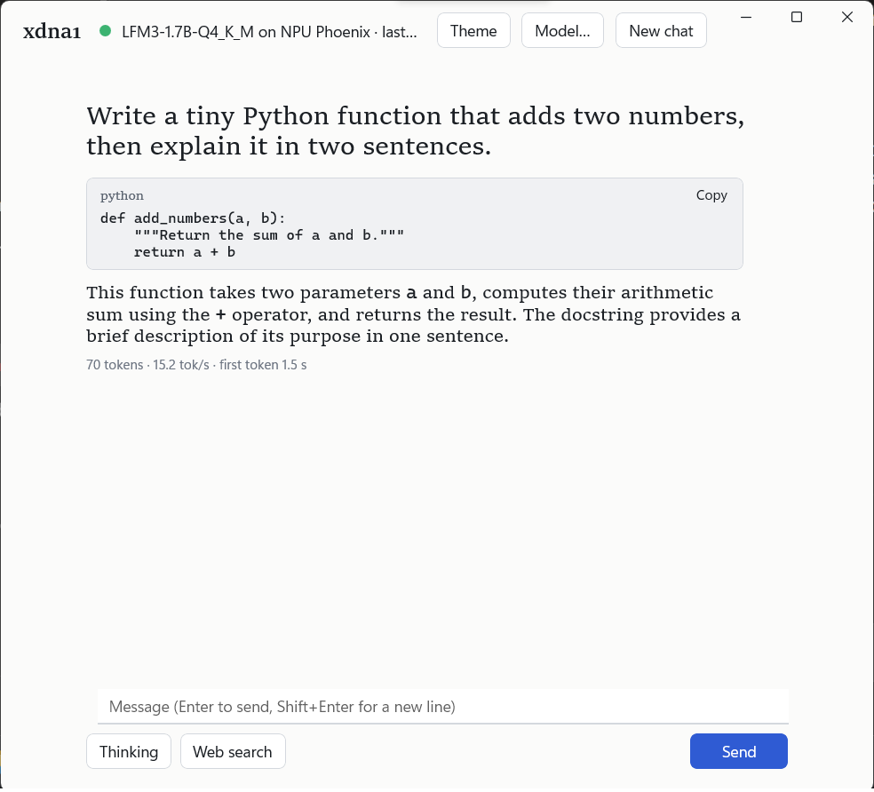
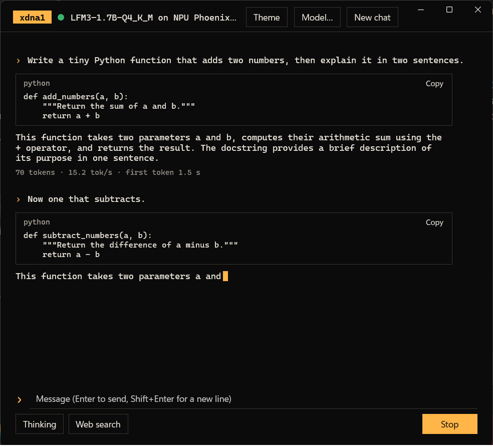
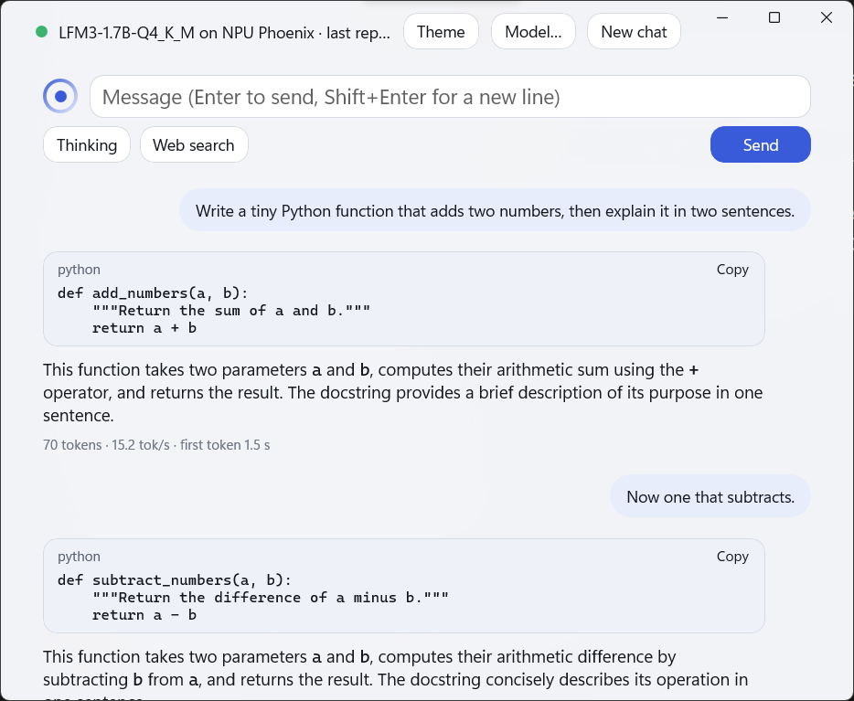
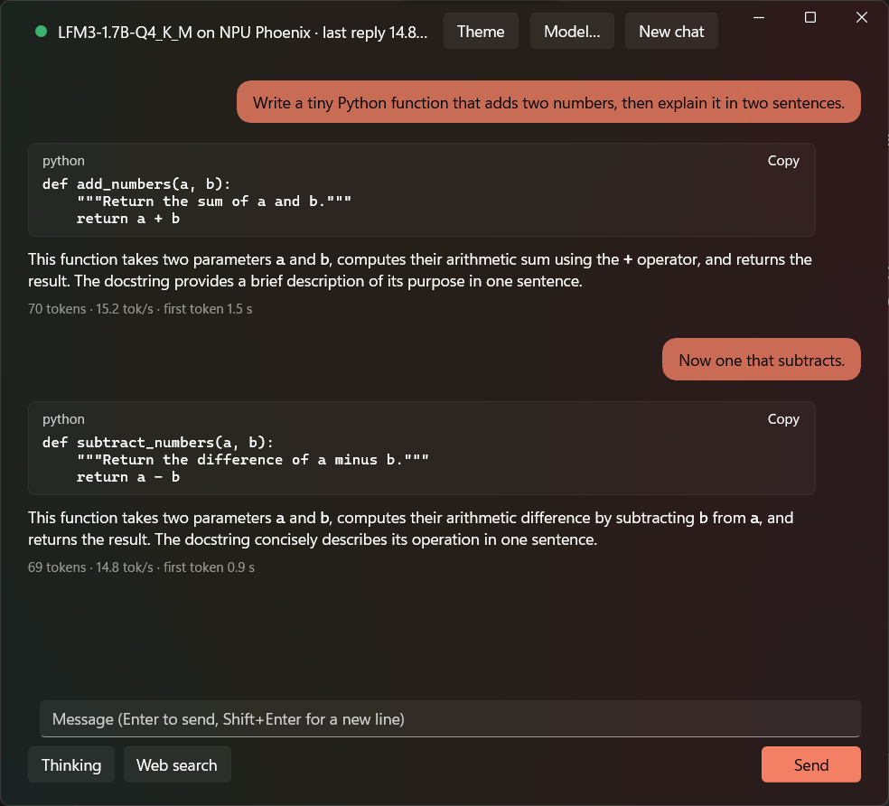

<div align="center">

# xdna1-llm

**Local LLMs on the NPU of Ryzen 7040 / 8040 / Ryzen 200 laptops**

[](https://github.com/sathish8839/xdna1-llm/actions/workflows/ci.yml)
[](LICENSE)

-ed1c24)


</div>

Millions of laptops have a first-generation AMD XDNA NPU (Phoenix / Hawk Point, 16 TOPS) that sits idle,
because today's NPU LLM stacks (FastFlowLM, Lemonade, Ryzen AI OGA and Unsloth's NPU backend) require XDNA 2.
**xdna1-llm runs LLMs on that NPU instead.** It starts with [LiquidAI LFM3-1.7B](https://huggingface.co/LiquidAI/LFM3-1.7B),
Q4_K_M at ~15 tokens/s, behind:

- a **native Windows chat app** with a thinking toggle, DuckDuckGo web search and five themes, and
- an **OpenAI-compatible local server**, so you can use it from Open WebUI, Unsloth Studio, IDE plugins or the
  OpenAI SDKs.

> [!NOTE]
> **v0.1, the first release.** Prefill and generation run on the NPU and match a CPU reference. It has been
> tested on one laptop and one NPU driver, so expect rough edges, and please send a
> [hardware report](https://github.com/sathish8839/xdna1-llm/issues/new?template=hardware-report.yml).

<p align="center"></p>

## Install

1. **Check for the NPU.** Device Manager should list an AMD NPU under **Neural processors**. If it doesn't, install
   the NPU driver from your PC maker's support page ([more](docs/setup.md#npu-driver)).
2. **Download** `xdna1-llm-setup-<version>.exe` from [Releases](https://github.com/sathish8839/xdna1-llm/releases).
3. **Run it.** It installs for your user, without an admin prompt. The installer is not code-signed yet, so
   Windows SmartScreen may say "Windows protected your PC": click **More info**, then **Run anyway**.
4. **Open xdna1 chat** from the Start menu and download a model: **Q4_K_M** (1.1 GB, fastest) or **Q6_K**
   (1.4 GB, closest to the original), or pick a GGUF file you already have. The first load takes about a minute
   while the weights are converted for the NPU (about 4 GB, kept in `%LOCALAPPDATA%\xdna1-llm\cache`); later
   loads take about 20 seconds.

Nothing leaves the machine except the model download and, when you turn it on, web search queries to DuckDuckGo.

## The app

**Theme** switches between five looks: Windows (native), Silicon (above), Paper, Console and Spotlight, a small
always-on-top window that Alt+Space shows or hides from anywhere.

| Paper | Console |
|---|---|
|  |  |
| **Spotlight** | **Windows** |
|  |  |

## Known issues

- The installer is not code-signed, so SmartScreen warns the first time.
- Tested on one laptop (Ryzen 7 250) with NPU driver 32.0.203.297. Newer drivers may refuse the NPU kernels;
  the app then says so in plain words.
- Only LFM3-1.7B is supported.
- Spotlight's Alt+Space can't be used while PowerToys Run holds it.

## Results so far

LFM3-1.7B BF16, 256-token prompt, Ryzen 7 250, Windows 11, on AC power:

| | tokens/s | SoC power | CPU load | energy per token |
|---|---:|---:|---:|---:|
| **xdna1-llm** (all linear layers on the NPU) | **149** | **26 W** | **14 %** | **0.12 J** |
| llama.cpp, CPU only (8 threads) | 95 | 38.5 W | 60 % | 0.30 J |

That is **1.6× faster and 2.5× less energy than the CPU, with the CPU nearly free.** The output matches llama.cpp
(top-5 tokens identical, logits cosine similarity 0.999998). Method, driver limits and per-shape numbers are in
[docs/benchmarks.md](docs/benchmarks.md).

## Status

| Feature | |
|---|---|
| NPU kernels compiled with mlir-aie, running on the **Windows** NPU driver | ✅ |
| Prefill with every linear layer on the NPU (bf16) | ✅ |
| Native tokenizer and chat template (identical to llama.cpp / the Jinja template), generation with sampling | ✅ |
| Decode on the NPU (KV cache): **Q4_K_M** ~14–15 tok/s, or **Q6_K** ~12–13 tok/s at near-BF16 accuracy | ✅ |
| Batched prompt on the NPU, reading the 4-bit weights directly (W4A16): ~180 tok/s, no extra RAM | ✅ |
| Accuracy harness: perplexity and KL divergence vs BF16; NPU engine adds ~0 on top of the GGUF | ✅ |
| OpenAI-compatible server (streaming, thinking, tool calls), ~14 tok/s through the OpenAI SDK | ✅ |
| Windows app: streaming markdown chat, thinking toggle, DuckDuckGo web search, five themes, NPU status and speed | ✅ |
| Installer with prebuilt kernels (built in CI); the app downloads the model on first run | ✅ |
| Norms, conv, attention and SwiGLU fused on the NPU | ⏳ |

## Supported hardware

| | |
|---|---|
| Processors | Ryzen 7040 "Phoenix", 8040 "Hawk Point" and Ryzen 200 series with a Ryzen AI (XDNA1) NPU |
| OS | Windows 11 with the AMD NPU driver (tested: 32.0.203.297) |
| Memory | 16 GB RAM recommended |

Only a Ryzen 7 250 has been tested so far. **Have one of these laptops? A
[hardware report](https://github.com/sathish8839/xdna1-llm/issues/new?template=hardware-report.yml) is the most
valuable contribution right now**, especially with newer NPU drivers.

## Build from source

`installer\build-installer.ps1` builds the installer from a checkout, and the release workflow builds it, kernels
included, in CI. To work on the engine you need the XRT SDK, plus WSL to build the kernels. The full guide is in
[docs/setup.md](docs/setup.md).

```powershell
cd engine
uv venv --python 3.13 .venv; .venv\Scripts\activate
uv pip install -e ".[dev]"
copy <xrt_sdk>\xrt\python\pyxrt.pyd .venv\Lib\site-packages\
python -m pytest -rs                       # CPU tests, plus NPU tests when kernels are built
xdna1-llm --gguf LFM3-1.7B-Q4_K_M.gguf --chat --prompt "Name three rivers." --generate 200 --sample  # chat (or Q6_K)
xdna1-llm-server --gguf LFM3-1.7B-Q4_K_M.gguf   # OpenAI API at http://127.0.0.1:8080/v1
xdna1-llm --gguf LFM3-1.7B-BF16.gguf --compare --llama-server <llama-server.exe>   # prefill vs CPU and llama.cpp
```

## How it works

```
 app (WinUI 3) ─┐
 any OpenAI ────┼─▶ engine (Python): server · tokenizer · LFM3 · Q4_K repack · pyxrt runtime
 client       ──┘                                                    │
                                                  XDNA1 NPU ◀────────┘  prebuilt npu1 kernels
```

The Windows XDNA1 driver allows **5 hardware contexts**, and switching between them costs **~1.45 ms**.
Swapping weight buffers inside one context is free. So the engine keeps a few long-lived kernels, uploads all
weights once, and streams every projection through them in 1024-wide chunks. Details are in
[docs/architecture.md](docs/architecture.md).

## Repository layout

```
engine/       Python engine: xdna1_llm package (npu runtime, models, GGUF, server, CLI) and tests
app/          Windows chat app (WinUI 3, C#)
installer/    portable build and Inno Setup installer
kernels/      scripts that build the npu1 kernels with mlir-aie (in WSL or Linux)
benchmarks/   GEMM shape, context-switch and power benchmarks
docs/         setup, architecture, benchmarks, roadmap
```

## Contributing

Contributions are welcome. See [CONTRIBUTING.md](CONTRIBUTING.md).

## Acknowledgements

Kernels are built from [mlir-aie / IRON](https://github.com/Xilinx/mlir-aie) programming examples (Apache-2.0 WITH
LLVM-exception). The runtime is [XRT](https://github.com/Xilinx/XRT). The model is LiquidAI LFM3 (LFM Open
License); its weights are not redistributed here. [llama.cpp](https://github.com/ggml-org/llama.cpp) is the
reference implementation. Related XDNA1 community work is listed in
[docs/benchmarks.md](docs/benchmarks.md#related-work).

Much of the code is written with Claude (Anthropic) as a coding assistant.

xdna1-llm is an independent project, not affiliated with AMD, Liquid AI or Unsloth.

## License

[Apache-2.0](LICENSE)
